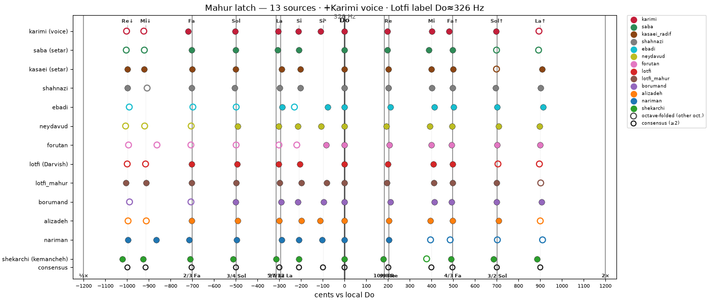

# dastgaah

Mahur pitch / latch analysis across setar, tar, oud, kemancheh, and voice — onset F0s, local-Do cents, octave-folded consensus.

## Latch fingerprint (best so far)

## Tuning reference

Best-guess setar intervals (Mahur), with absolute Hz at a few reference Dos:

[`analysis/setar_tuning_mahur_best_guess.csv`](analysis/setar_tuning_mahur_best_guess.csv)

| degree | cents vs Do | ratio |
|---|---|---|
| Fa↓ | −702 | **2/3** |
| Sol↓ | −498 | **3/4** |
| La↓ | −294 | **27/32** (fret-forced ≈ 9/8 × Sol) |
| Re | +204 | **9/8** |
| Mi | +400 | ≈ ET (between 5/4 and 81/64) |
| Fa↑ / Sol↑ | +498 / +702 | **4/3** / **3/2** |

## Notebook

[`notebooks/setar_pitch_start.ipynb`](notebooks/setar_pitch_start.ipynb) — env `micromamba activate freqs`.

Cached strikes / consensus live under `analysis/` (`strikes_*.npz`, `consensus_template.json`). Audio is gitignored.
